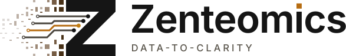
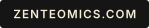

<!-- markdownlint-disable MD033 MD041 -->

<picture>
  <source media="(prefers-color-scheme: dark)" srcset="../assets/zenteomics-lockup-horizontal-on-dark.svg">
  <source media="(prefers-color-scheme: light)" srcset="../assets/zenteomics-lockup-horizontal-on-light.svg">
  
</picture>

Computational biology: proteomics, pipeline engineering, and fast, lean scientific software.

&nbsp;
&nbsp;

<picture>
  <source media="(prefers-color-scheme: dark)" srcset="../assets/zenteomics-divider-field-dark.svg">
  <source media="(prefers-color-scheme: light)" srcset="../assets/zenteomics-divider-field-light.svg">
  
</picture>

Zenteomics is a one-person computational biology practice in Vancouver, BC. I'm Enes K. Ergin. I help research groups get results they can defend, from raw data to final figure. The person who scopes your project is the person who does the work.

<h3>What Zenteomics does</h3>

- **Proteomics analysis.** Analysis support, QC and reproducibility review, and statistical rescue for mass spectrometry studies.
- **Pipelines and workflows.** Pipeline engineering and workflow cleanup for analyses that have to be rerun and audited.
- **Performance.** Tools that stay fast and small on large data, measured rather than assumed.
- **Genomics.** Sequencing data analysis, including gene fusion detection.

<h3>Projects</h3>

- [kanit](https://github.com/Zenteomics/kanit): a workflow engine for one Linux workstation. Every task stays within budget, and every attempt is on record.
- [awesome-proteomics](https://github.com/Zenteomics/awesome-proteomics): a curated list of proteomics tools, databases, workflows and learning resources, with guides and practitioner pipelines.

Smaller open-source tools I maintain personally, for mzML, FASTA and FASTQ, compression and benchmarking, are on [my GitHub profile](https://github.com/eneskemalergin).

<h3>How I work</h3>

- **Explicit assumptions.** Every analytical choice is written down.
- **Inspectable outputs.** Results can be read, rerun and audited.
- **Scoped work.** Inputs, outputs and boundaries are agreed before work starts.
- **Stated limits.** Every deliverable says what the data cannot support.

Have data and a question? Describe your data, your question and your timeline. No forms, just email.

<picture>
  <source media="(prefers-color-scheme: dark)" srcset="../assets/zenteomics-divider-field-dark.svg">
  <source media="(prefers-color-scheme: light)" srcset="../assets/zenteomics-divider-field-light.svg">
  
</picture>

